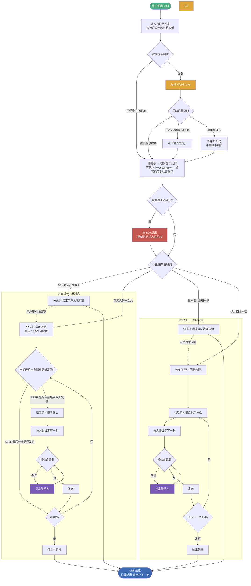

# wechat-send 完整流程图

> 一张图看完整个 Skill。每一步的参数、判据、踩坑记录见 `SKILL.md`。

## 四个分支怎么两两合并

| 分支组 | 两个分支 | 关系 |
|---|---|---|
| 一 · 发消息 | ① 指定联系人发消息 → ② 循环对话 | ② 是 ① 的延伸：先按 ① 找到人发第一句，再进入循环接着聊 |
| 二 · 处理未读 | ③ 看未读 / 清理 → ④ 读并回复未读 | ④ 是 ③ 的延伸：先按 ③ 拿到未读清单并点开，再对每条写回复 |

**关键词怎么分到四个分支：**

| 用户说法 | 分支 |
|---|---|
| 「给 X 发…」「告诉 X…」 | ①，发完即结束 |
| 「跟 X 聊会儿」「跟 X 聊 10 分钟」「陪 X 说几句」 | ②，先走 ① 发第一句再循环 |
| 「看看谁找我」「消息清理」「全部清掉」 | ③，清理只标记已读不回复 |
| 「看看他们说了什么，该回的回一下」 | ④，点开后逐条回复 |

## 三个必须看一眼再按的动作

清空输入框、核对几何、置顶这类可以盲按。下面三个不行：

1. **点搜索结果第一行** —— 可能点到历史记录或公众号，消息会发错人
2. **按 Esc** —— 不在多选模式时按，可能关掉当前会话
3. **按回车发送** —— 发出去收不回

## 固定几何基准（屏幕 2560×1600 实测定标）

| 项目 | 值 |
|---|---|
| 屏幕 | 2560×1600 |
| 窗口外框 | 1174×1187 @ (1391, 205) |
| 客户区 | 1152×1176，屏幕原点 (1402, 205) |
| 搜索框 | 客户区 (240, 84) |
| 会话首行 | 客户区 (240, 270)，行高 ≈96 |
| 输入区 | 客户区 (730, 1090) |

换屏幕时全部按 `$scale = 屏幕宽 / 2560` 等比缩放。

## 人物性格设定

**人物性格由用户设定，Skill 不预设。** 用户没说时用默认：话多点但不说废话，情绪来得快去得也快，嘴上硬心里软。

**说话：** 句子短，一句话说一件事。不排比、不堆形容词、不总结陈词。

**禁：** 文案腔套路句（「认识你很高兴」「笑容如阳光般温暖」）；把三件事塞一段；括号注解。

**发前默念：** 像不像真人此刻在微信里打的？有没有在抒情或给建议？能不能砍一半？

> 用户给定具体性格、口头禅、称呼、字数上限时，以用户设定为准，覆盖以上默认值。